# Практическая работа № 1. Диагностические утилиты TCP/IP
# Выполнил: студент Куклин Глеб ИСТ-33
## Задание 1. Получение справочной информации по командам

В ходе выполнения первого этапа работы с помощью ключа `/?` в командной строке Windows была вызвана и изучена справочная документация по базовым сетевым утилитам: `ipconfig`, `ping`, `tracert` и `hostname`.

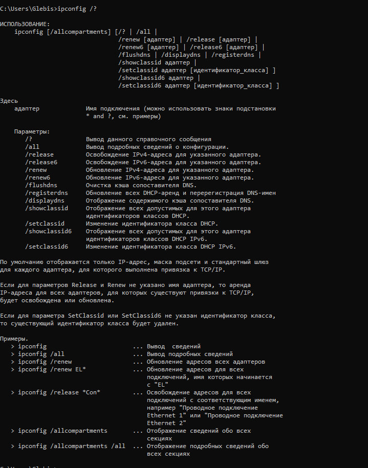

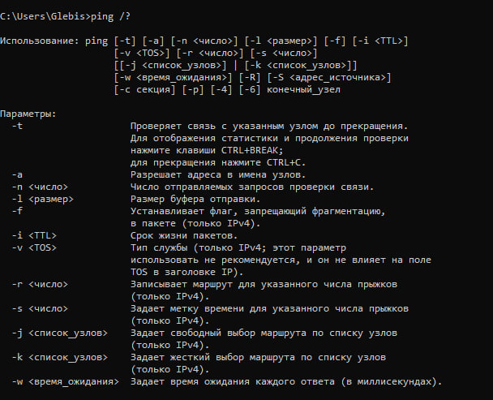

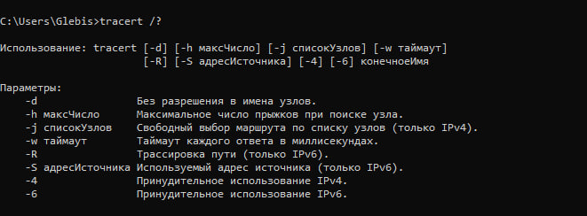

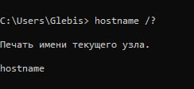
### Анализ параметров запуска утилит:
* **`ipconfig`**: отвечает за отображение и управление конфигурацией стека TCP/IP. Ключевые параметры:
  * `/all` — вывод исчерпывающей информации по всем сетевым интерфейсам, включая MAC-адреса и DNS;
  * `/release` — освобождение текущего динамического IP-адреса;
  * `/renew` — повторный запрос и обновление сетевых параметров у DHCP-сервера;
  * `/displaydns` — просмотр содержимого локального кэша DNS-клиента.
* **`ping`**: предназначена для проверки доступности узлов и оценки задержек. Ключевые параметры:
  * `-t` — непрерывная отправка эхо-запросов до ручной остановки сочетанием `Ctrl+C`;
  * `-n count` — задание точного количества отправляемых пакетов;
  * `-l size` — установка размера буфера отправки в байтах;
  * `-w timeout` — задание максимального времени ожидания ответа в миллисекундах.
* **`tracert`**: используется для трассировки маршрута следования пакетов. Ключевые параметры:
  * `-d` — отключение преобразования IP-адресов промежуточных узлов в доменные имена для ускорения работы;
  * `-h maximum_hops` — ограничение максимального числа прыжков при поиске цели;
  * `-w timeout` — интервал ожидания ответа для каждого пакета.
* **`hostname`**: не имеет дополнительных ключей управления и служит исключительно для быстрого вывода сетевого имени текущего локального узла.

---

## Задание 2. Получение имени хоста

С помощью команды `hostname` было получено сетевое имя рабочего места, под которым компьютер идентифицируется другими устройствами и серверами в локальной сети: **`DESKTOP-JJ7GA45`**.

---

## Задание 3. Изучение утилиты `ipconfig`

Для диагностики сетевых интерфейсов была выполнена команда `ipconfig /all`. На основании полученных данных о текущем активном подключении заполнена **Таблица 1.3**.

| Параметр | Значение |
| :--- | :--- |
| **Имя хоста** | `DESKTOP-JJ7GA45` |
| **IP-адрес** | `192.168.0.8` |
| **Маска подсети** | `255.255.255.0` |
| **Основной шлюз** | `192.168.0.1` |
| **Используется ли DHCP (адрес DHCP-сервера)** | `Да (192.168.0.1)` |
| **Описание адаптера** | `Realtek Gaming GbE Family Controller` |
| **Физический адрес сетевого адаптера** | `18-C0-4D-7E-53-72` |
| **Адрес DNS-сервера** | `9.9.9.9`, `149.112.112.112` |
| **Адрес WINS-сервера** | `Не задан` |

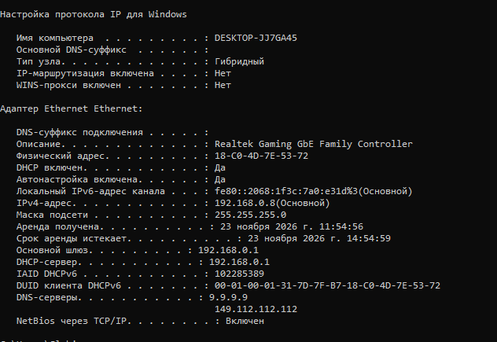
### Выводы по Заданию 3

**1. Определения параметров сетевой конфигурации:**
* **Имя хоста** — уникальное символьное имя, присвоенное компьютеру в операционной системе для его идентификации в локальной сети.
* **IP-адрес** — уникальный числовой сетевой идентификатор узла в сети, работающей по протоколу IP, необходимый для маршрутизации и доставки пакетов данных.
* **Маска подсети** — 32-битная маска, разделяющая IP-адрес на две логические части: адрес самой подсети и адрес конкретного хоста внутри нее.
* **Основной шлюз** — IP-адрес локального маршрутизатора (роутера), через который весь сетевой трафик, предназначенный для внешних сетей, выходит за пределы локальной подсети в Интернет.
* **DHCP (и адрес DHCP-сервера)** — протокол динамической настройки узла, который автоматически выдает устройствам IP-адреса и параметры сети из доступного пула при подключении.
* **Описание адаптера** — программно-аппаратное наименование сетевого интерфейса (контроллера Ethernet или модуля беспроводной связи Wi-Fi), обеспечивающего физическое подключение к среде передачи данных.
* **Физический адрес (MAC-адрес)** — уникальный 48-битный аппаратный идентификатор, записываемый производителем в сетевую карту на этапе изготовления и работающий на канальном уровне.
* **Адрес DNS-сервера** — IP-адрес сервера системы доменных имен, который выполняет преобразование текстовых доменных имен сайтов в понятные компьютерам IP-адреса.
* **Адрес WINS-сервера** — адрес службы сопоставления NetBIOS-имен компьютеров с их IP-адресами в локальных сетях Windows (в современных сетях обычно не используется).

**2. Практическая значимость полученных данных:**
Анализ вывода `ipconfig /all` является первым и обязательным этапом сетевой диагностики. Разработчику и сетевому администратору эти сведения позволяют убедиться, что стек TCP/IP корректно инициализирован, проверить отсутствие конфликта (дублирования) IP-адресов в локальной сети (при дублировании маска сбрасывается в `0.0.0.0`), проконтролировать исправность работы DHCP-сервера, а также определить адреса шлюза и DNS для выявления причин отсутствия доступа к внешним веб-ресурсам или локальным серверам разработки.

---

## Задание 4. Получение информации о текущих сетевых соединениях и протоколах стека TCP/IP

С помощью утилиты `netstat` (с ключами `-a` и `-s`) был получен перечень активных сетевых соединений и прослушиваемых портов, а также сводная статистика по протоколам стека TCP/IP.

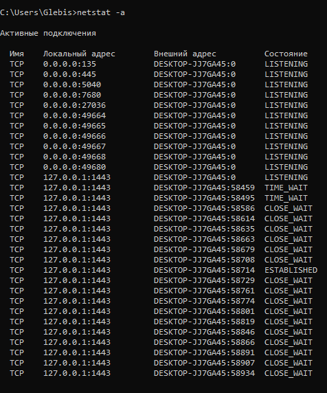

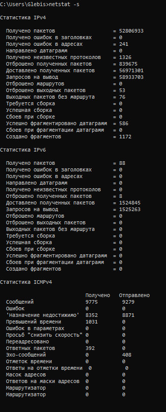
### Выводы по Заданию 4
* **Что иллюстрируют полученные результаты:** вывод команды `netstat -a` демонстрирует таблицу всех текущих сетевых подключений по протоколам TCP и UDP, отображая локальные и удаленные IP-адреса, номера используемых портов и текущее состояние сессий (`LISTENING` — порт открыт и ожидает подключений; `ESTABLISHED` — соединение активно; `TIME_WAIT` — ожидание закрытия сессии). Вывод команды `netstat -s` агрегирует счетчики статистики для протоколов IP, ICMP, TCP и UDP: число принятых/отправленных пакетов, ошибок и повторных передач.
* **Практическая ценность утилиты:** позволяет быстро проверить, запущен ли локальный веб-сервер и какой порт он прослушивает, выявить конфликты занятых портов, обнаружить несанкционированную сетевую активность, а также оценить качество канала связи по количеству ошибок передачи.

---

## Задание 5. Выбор ресурса для исследования доступа

* **Вариант:** № 2 — Веб-приложение платформы социальной сети.
* **Выбранный сетевой ресурс:** `vk.com` (социальная сеть «ВКонтакте»).

**Обоснование выбора ресурса:**
Согласно классификации сетевых ресурсов, платформа `vk.com` соответствует критериям веб-приложения социальной сети:
1. **Доступность и архитектура:** взаимодействие с платформой осуществляется через веб-браузер без обязательной локальной установки ПО по архитектуре клиент-сервер.
2. **Высокая интерактивность:** в отличие от информационных веб-сайтов, ресурс обеспечивает двустороннее взаимодействие — обмен мгновенными сообщениями, публикацию медиафайлов, комментирование и обновление ленты в реальном времени.
3. **Сложная обработка данных:** работа платформы опирается на распределенные базы данных, механизмы аутентификации учетных записей и персонализированную выдачу контента.

---

## Задание 6. Тестирование связи с помощью утилиты `ping`

Для поэтапной проверки работоспособности сетевого стека и доступности выбранного ресурса проведены четыре тестовых запуска утилиты `ping`, использующей эхо-запросы и эхо-ответы протокола ICMP.

**a. Проверка правильности установки и конфигурирования TCP/IP на локальном компьютере (`ping 127.0.0.1`):**
Запрос направлен на адрес петли обратной связи (loopback). Все 4 отправленных пакета размером 32 байта успешно вернулись (0% потерь) со временем отклика менее 1 мс. Это подтверждает, что драйверы сетевого адаптера и стек протоколов TCP/IP установлены и функционируют без сбоев.

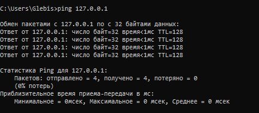
**b. Проверка правильности добавления компьютера в сеть и отсутствия дублирования IP-адреса (`ping 192.168.0.8`):**
Пакеты отправлены на собственный локальный IPv4-адрес компьютера в подсети. Все 4 пакета доставлены без потерь (0% потерь). Это доказывает, что сетевой интерфейс корректно зарегистрирован в локальной сети и конфликт одинаковых IP-адресов отсутствует.

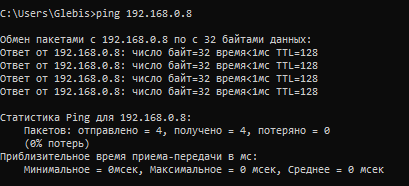
**c. Проверка функционирования шлюза по умолчанию (`ping -n 5 -l 64 192.168.0.1`):**
На IP-адрес маршрутизатора локальной сети отправлено 5 эхо-пакетов размером 64 байта. Получены все 5 ответов (0% потерь) с минимальной задержкой, что свидетельствует о стабильной связи между компьютером и роутером.

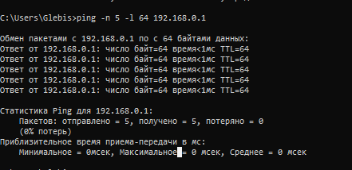
**d. Проверка возможности установления соединения с удаленным хостом (`ping vk.com`):**
Служба DNS успешно преобразовала доменное имя `vk.com` в IPv4-адрес удаленного сервера. Все 4 пакета успешно прошли до сервера и вернулись обратно (0% потерь), что подтверждает наличие выхода в Интернет и доступность ресурса.

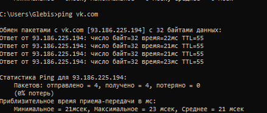
---

## Задание 7. Определение пути IP-пакета

С помощью утилиты `tracert vk.com` выполнена трассировка маршрута следования пакетов от локального компьютера до сервера выбранного сетевого ресурса.

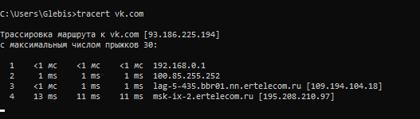
**Объяснение результатов трассировки:**
Утилита `tracert` определяет маршрут путем отправки серии пробных ICMP-пакетов с пошаговым увеличением поля TTL (Time-To-Live) от 1 и выше. Каждый промежуточный маршрутизатор уменьшает значение TTL на единицу и при достижении нуля возвращает сообщение `ICMP Time Exceeded`, что позволяет зафиксировать его IP-адрес и измерить время прохождения трех пробных пакетов (в миллисекундах).
* Первым прыжком (хопом) выступает локальный шлюз по умолчанию (домашний роутер).
* Последующие промежуточные узлы принадлежат инфраструктуре интернет-провайдера и магистральным операторам связи.
* Заключительный узел представляет собой целевой сервер ресурса `vk.com`.

*(Если на отдельных этапах вместо времени отклика отображаются символы `* * *`, это означает, что данный маршрутизатор настроен политикой безопасности на игнорирование диагностических ICMP-запросов).*

---

## Общий вывод по практической работе

В ходе выполнения практической работы были освоены базовые диагностические утилиты стека протоколов TCP/IP в операционной системе Windows (`hostname`, `ipconfig`, `netstat`, `ping`, `tracert`). На практике отработана методика поэтапной диагностики сетевых неисправностей: от проверки локальной конфигурации и отсутствия конфликтов IP-адресов до оценки качества связи со шлюзом, анализа активных портов и трассировки маршрута до удаленного веб-приложения в сети Интернет.

