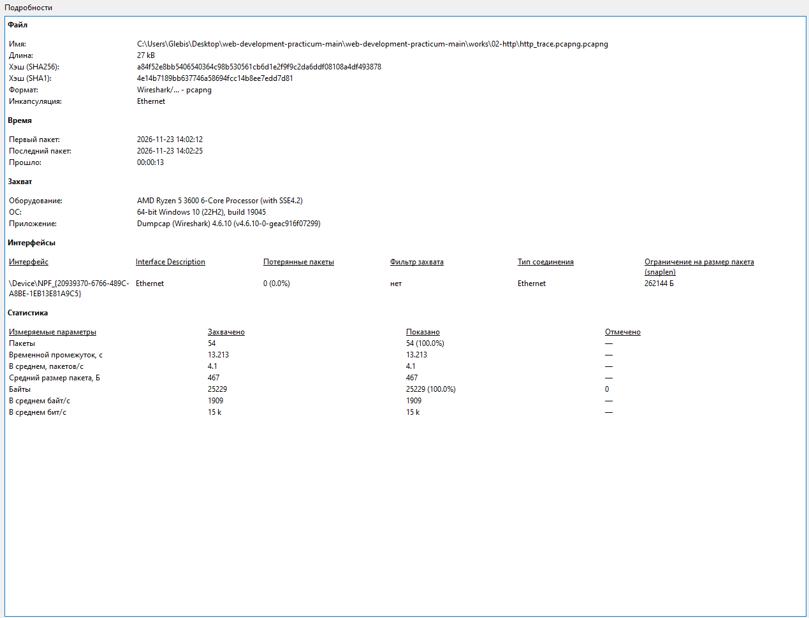
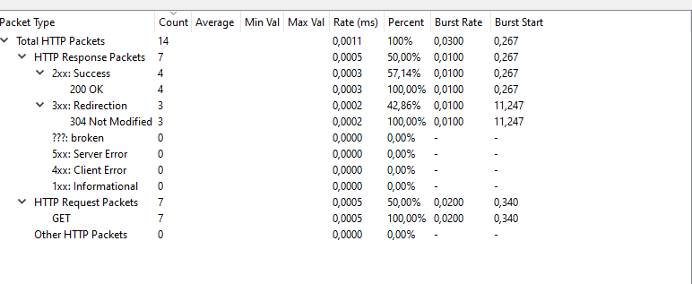
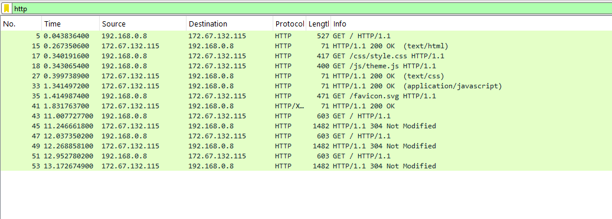
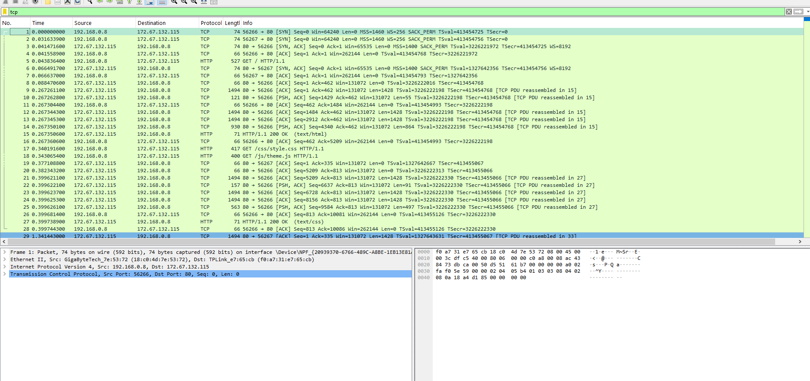
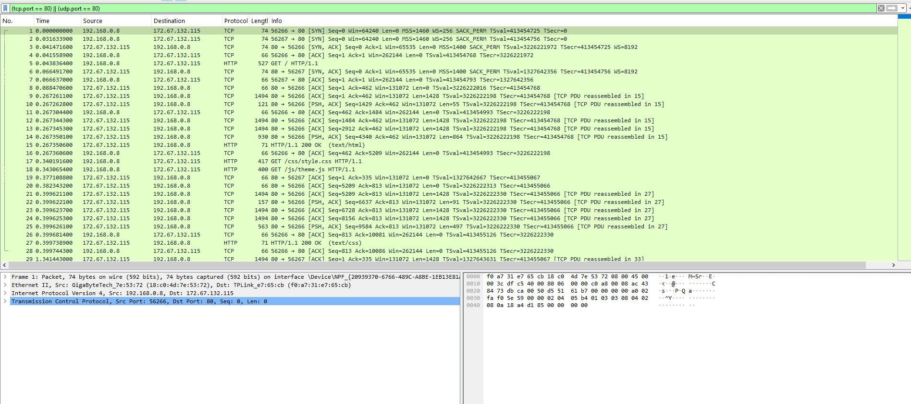
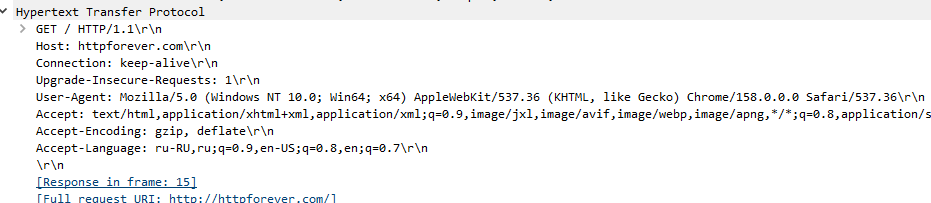
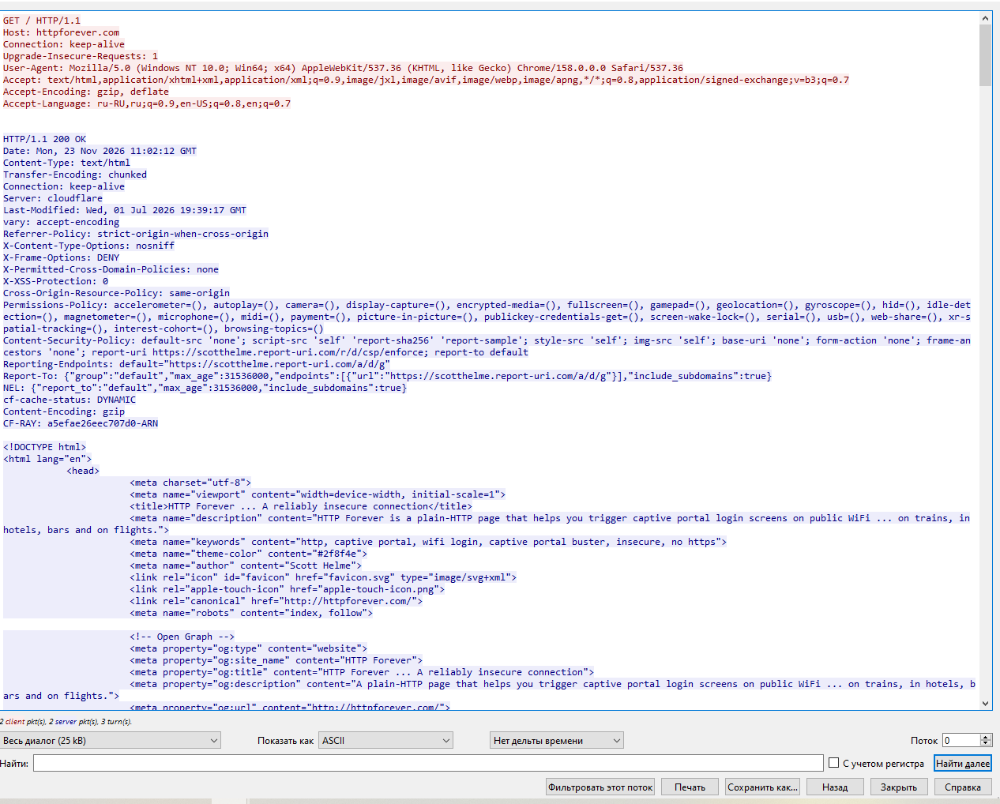

# Практическая работа № 2. Анализ протокола HTTP
# Выполнил студент Куклин Глеб ИСТ-33
## 1. Общая статистика файла трассировки

Для анализа использован файл трассировки `http_clean.pcapng` (54 пакета), записанный при обращении к веб-ресурсу `http://httpforever.com` (IP-адрес сервера `172.67.132.115`).

Через меню **Statistics → Capture File Properties** получены общие характеристики захвата:
* **Общее количество пакетов (Packets):** `54`
* **Общий объём трафика (Bytes):** `25 229` байт

---

## 2. Статистика HTTP-запросов и HTTP-ответов

С помощью встроенного анализатора **Statistics → HTTP → Packet Counter** подсчитано распределение пакетов протокола HTTP:
* **Количество HTTP Request (запросов):** `7` (все выполнены методом `GET`: загрузка главной страницы `/`, стилей `/css/style.css`, скрипта `/js/theme.js`, иконки `/favicon.svg` и 3 повторных запроса главной страницы при обновлении).
* **Количество HTTP Response (ответов):** `7`:
  * `4` ответа со статусом **`200 OK`** (пакеты № 15, 27, 33, 41 — успешная передача ресурсов);
  * `3` ответа со статусом **`304 Not Modified`** (пакеты № 45, 49, 53 — подтверждение актуальности кэшированной версии страницы при повторных запросах).

---

## 3. Применение фильтров отображения

Для выделения целевого трафика в строке фильтрации Wireshark поэтапно применялись следующие фильтры:

### а) Фильтрация по протоколу HTTP (`http`)
Фильтр отображает исключительно 14 пакетов прикладного уровня (7 запросов и 7 ответов), скрывая служебный транспортный трафик.

### б) Фильтрация по протоколу TCP (`tcp`)
Фильтр отображает все 54 сегмента транспортного уровня, включая процедуру трехэтапного рукопожатия (`SYN`, `SYN-ACK`, `ACK` в пакетах № 1–4 и № 6–7), сегменты передачи данных HTTP и подтверждения доставки (`ACK`).

### в) Фильтрация по транспортным протоколам TCP/UDP и порту 80 (`(tcp.port == 80) || (udp.port == 80)`)
Фильтр выделяет весь сетевой обмен, проходящий через стандартный порт `80`, зарезервированный для незашифрованного веб-трафика HTTP. Все 54 пакета сессии передаются поверх протокола TCP (порт клиента `56266`/`56267` → порт сервера `80`).

---

## 4. Анализ HTTP GET-запроса и его заголовков

Из списка пакетов выбран первый запрос на получение корневой страницы (`GET / HTTP/1.1`, **пакет № 5**). В средней панели декодирования протоколов раскрыта секция **Hypertext Transfer Protocol**.

**Разбор основных полей и заголовков запроса:**
* **Request Method / URI / Version (`GET / HTTP/1.1`):** метод `GET` запрашивает у сервера содержимое ресурса по корневому пути `/` с использованием версии протокола `HTTP/1.1`.
* **Host (`httpforever.com`):** обязательный заголовок в HTTP/1.1, указывающий доменное имя целевого веб-сервера.
* **User-Agent:** строка идентификации клиентского приложения (название и версия веб-браузера, а также операционной системы пользователя).
* **Accept:** перечень MIME-типов данных, которые браузер готов принять и корректно отобразить (`text/html`, `application/xhtml+xml` и др.).
* **Accept-Language:** предпочитаемый язык интерфейса и контента для ответа сервера.
* **Accept-Encoding:** поддерживаемые клиентом алгоритмы сжатия трафика (`gzip`, `deflate`).
* **Connection (`keep-alive`):** указание серверу не разрывать TCP-соединение сразу после ответа, чтобы повторно использовать его для загрузки стилей (`/css/style.css`) и скриптов (`/js/theme.js`).

---

## 5. Исследование HTTP-ответа и передаваемых данных

Для анализа ответной реакции сервера выбран соответствующий ответ на корневой запрос (**пакет № 15**, `HTTP/1.1 200 OK (text/html)`) и использован инструмент **Follow → HTTP Stream**.

**Разбор заголовков ответа и передаваемых данных:**
* **Status Code (`HTTP/1.1 200 OK`):** код состояния `200` означает, что запрос клиента успешно принят, обработан, а запрошенный HTML-документ найден и передается в теле ответа.
* **Server:** информация о программном обеспечении веб-сервера (`cloudflare`).
* **Content-Type (`text/html`):** указывает браузеру, что в теле ответа передается HTML-документ (веб-страница) и его кодировку (`charset=utf-8`).
* **Date / Last-Modified / ETag:** дата формирования ответа и метаданные для кэширования (благодаря которым при повторных запросах в пакетах № 45, 49 и 53 сервер вернул код `304 Not Modified` без повторной отправки тела страницы).
* **Тело сообщения (Payload):** после пустой строки, отделяющей заголовки от данных, передается исходный HTML-код веб-страницы (`<!DOCTYPE html>...`), собранный из TCP-сегментов (пакеты № 9, 10, 12–14).

---

## Вывод

В ходе выполнения практической работы освоены методы захвата и анализа сетевого трафика в анализаторе пакетов Wireshark. На практике изучена структура взаимодействия клиента и веб-сервера по протоколу HTTP поверх TCP (порт 80): проанализированы статистика сессии (54 пакета, 7 запросов и 7 ответов), механизм работы фильтров отображения, структура заголовков запроса `GET`, структура ответа сервера `200 OK` с передачей HTML-контента, а также работа механизма кэширования (`304 Not Modified`).
