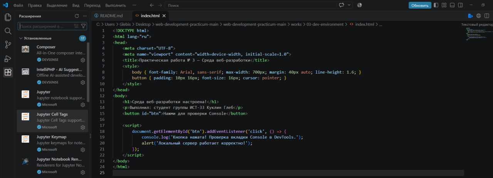
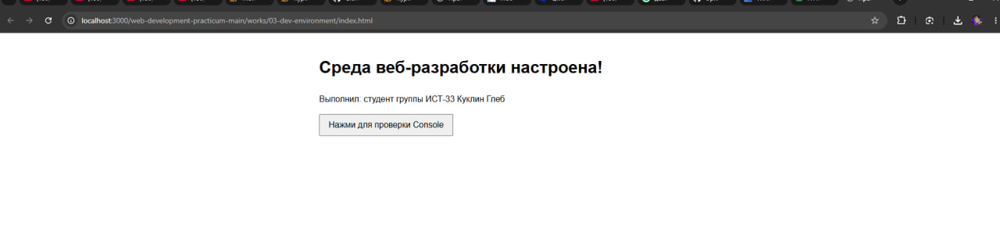
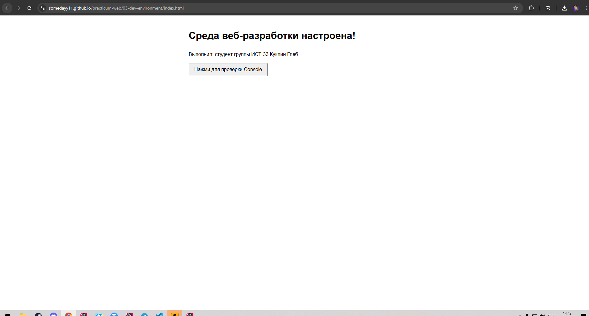
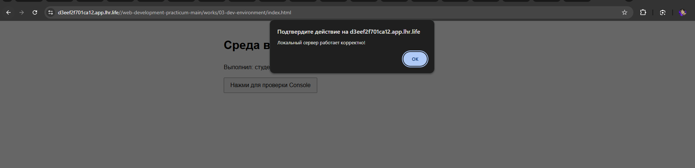
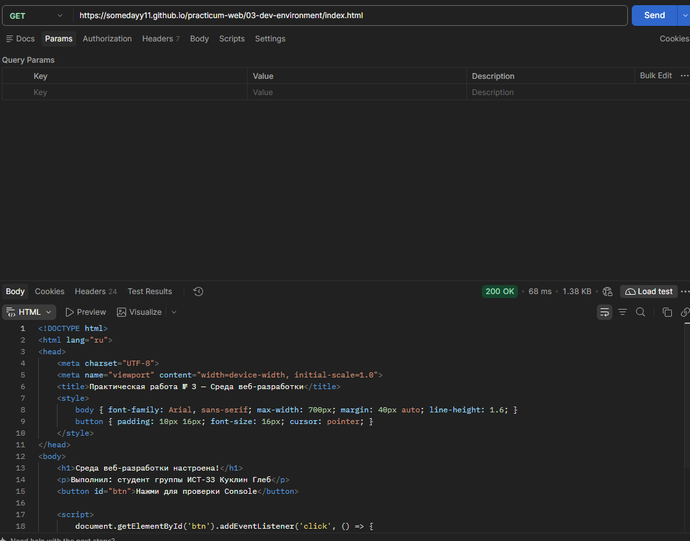
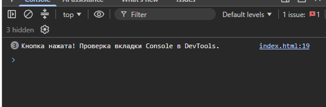
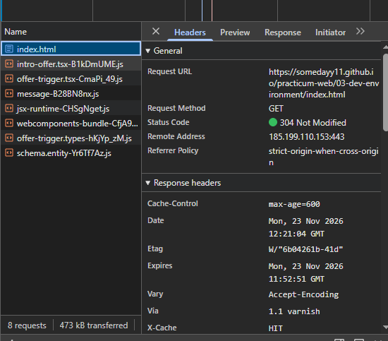
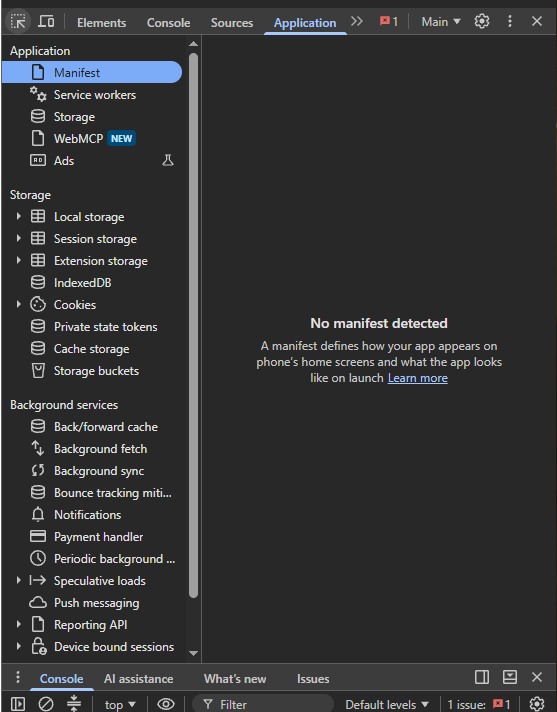

# Практическая работа № 3. Настройка среды веб-разработки

*Выполнил студент группы ИСТ-33 Куклин Глеб*

---

## 1. Настройка Visual Studio Code и создание первой веб-страницы

Для разработки веб-приложений установлен и настроен редактор кода **Visual Studio Code**. Установлены необходимые расширения для фронтенд-разработки и работы с документацией (инструменты поддержки HTML/CSS/JS, PHP и Markdown).

В рабочей директории `works/03-dev-environment/` создан базовый документ `index.html`, содержащий стандартную структуру HTML5 (`<!DOCTYPE html>`, `<html>`, `<head>`, `<body>`), встроенные стили CSS и интерактивный скрипт на JavaScript для тестирования консоли браузера.

---

## 2. Запуск локального веб-сервера

Для локального тестирования веб-страницы запущен встроенный локальный веб-сервер разработки на порту `3000` (`http://localhost:3000`). Данный инструмент позволяет корректно обрабатывать HTTP-запросы к файлам проекта в среде, приближенной к реальному хостингу.

---

## 3. Публикация страницы через GitHub Pages

Исходный код проекта загружен в публичный репозиторий на платформе **GitHub**. В настройках репозитория (*Settings → Pages*) активирован хостинг статических сайтов **GitHub Pages**, в результате чего веб-страница стала доступна в глобальной сети Интернет по постоянному HTTPS-адресу.

---

## 4. Организация внешнего доступа к локальному серверу (туннелирование)

Для демонстрации локально запущенного приложения из внешней сети настроено защищенное HTTPS-туннелирование локального порта `3000`. В связи с региональными ограничениями доступа к сервису `ngrok` для пользователей из РФ в качестве полного функционального аналога использован сервис **`localhost.run`**.

С помощью встроенного в Windows SSH-клиента выполнена команда `ssh -R 80:localhost:3000 nokey@localhost.run`, в результате чего был поднят внешний защищенный шлюз (`https://lhr.life`), перенаправляющий внешние HTTPS-запросы на локальный веб-сервер (`localhost:3000`).

---

## 5. Тестирование HTTP-запросов в Postman

Для тестирования взаимодействия с веб-сервером и отладки API освоена платформа **Postman**. Сформирован и отправлен тестовый `GET`-запрос к развернутой веб-странице (`http://localhost:3000/web-development-practicum-main/works/03-dev-environment/index.html`). В ответ от сервера получен статус **`200 OK`**, заголовки ответа (`Content-Type: text/html`) и исходный HTML-документ в теле ответа.

---

## 6. Исследование инструментов разработчика Chrome DevTools

С помощью встроенной панели разработчика браузера (**Chrome DevTools**, вызов по клавише `F12`) изучены ключевые вкладки для отладки и профилирования веб-приложений:

1. **Elements и Console:** вкладка *Elements* позволяет инспектировать и изменять DOM-структуру документа и CSS-стили в реальном времени; во вкладке *Console* проверен вывод диагностических сообщений JavaScript (`console.log`) при нажатии на кнопку.

2. **Network:** проанализирована сетевая активность при загрузке страницы — зафиксирован запрос к `index.html`, код ответа 304 Not Modified (загрузка из кэша браузера), заголовки HTTP, размер переданных данных и временная диаграмма загрузки (Waterfall).

3. **Application, Performance, Memory и Security:**
   * *Application* — проверены локальные хранилища браузера (`Local Storage`, `Session Storage`, `Cookies`);
   * *Performance и Memory* — изучены инструменты замера производительности рендеринга и потребления оперативной памяти;
   * *Security* — проверен статус безопасности соединения и TLS-сертификата (при обращении по HTTPS).

---

## Вывод

В ходе выполнения практической работы была полностью настроена современная среда веб-разработки: подготовлен редактор Visual Studio Code и локальный веб-сервер разработки (`localhost:3000`), освоены два способа публикации веб-приложений (постоянный хостинг через GitHub Pages и временное HTTPS-туннелирование локального порта в глобальную сеть через `localhost.run`), отработана отправка HTTP-запросов в Postman и изучены инструменты инспектирования и отладки страниц в Chrome DevTools.

